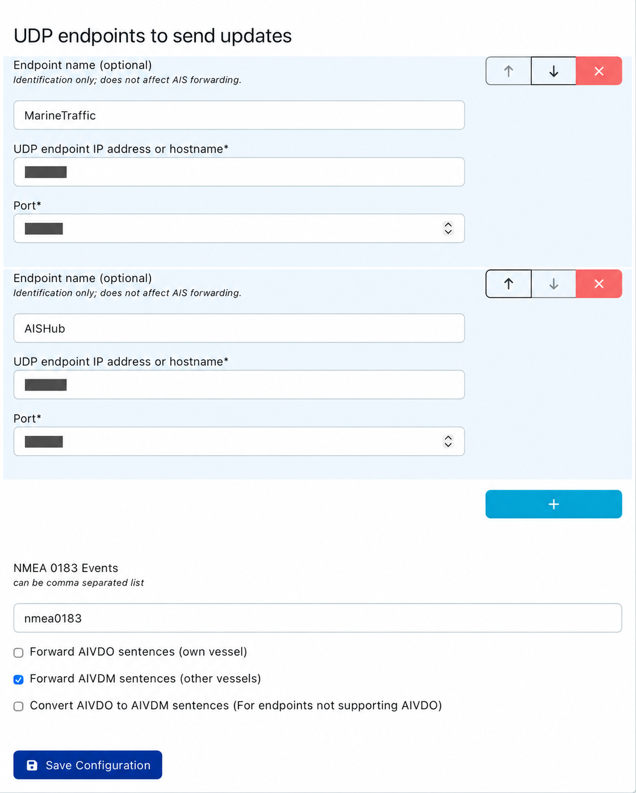

# ais-forwarder

[Signal K Node server](https://github.com/SignalK/signalk-server-node) plugin to forward [NMEA0183 AIS messages](https://gpsd.gitlab.io/gpsd/AIVDM.html) over UDP. This enables your vessel to double as a [MarineTraffic roaming station](https://help.marinetraffic.com/hc/en-us/articles/205282657-Add-an-AIS-Receiving-Station-to-the-MarineTraffic-Network), [AISHub Station](https://www.aishub.net/) or both.

Each UDP endpoint can optionally have a `name` to make destinations easier to identify. The name is displayed alongside the hostname/IP address and port in plugin status messages and diagnostic logs. It is used for identification only and does not affect AIS forwarding behavior.
## Plugin Activity

AIS Forwarder reports forwarding activity to Signal K's built-in Plugin Activity indicator in the dashboard. This provides a quick visual check that AIS messages are being forwarded.

Each AIS sentence is counted once when at least one local UDP send completes without an error, regardless of how many destinations are configured. Filtered or unsent messages are not counted.

**Important:** Activity indicates successful local UDP sends, not confirmed delivery. UDP does not provide delivery acknowledgements, so a successful local send does not guarantee that a remote receiver has received or processed the message.

This plugin can also be used with NMEA 2K AIS receivers by converting the data first to NMEA 0183 format for example with [signalk-n2kais-to-nmea0183 plugin](https://github.com/sbender9/signalk-n2kais-to-nmea0183). In this case `nmea0183out` must be used as an NMEA 0183 Event in the ais-forwarder plugin configuration.

Output can be debugged with `nc -ulkw 0 <ipaddress> <port>`.

NOTE: Existing plugin users upgrading from version 0.2 or below to 0.3 or higher need to re-configure their endpoints!